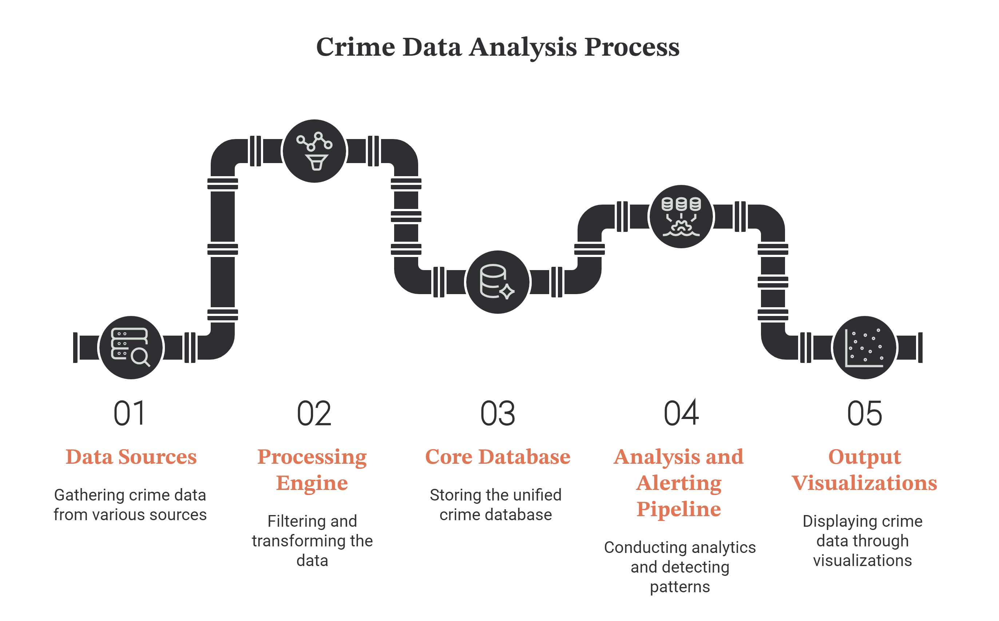
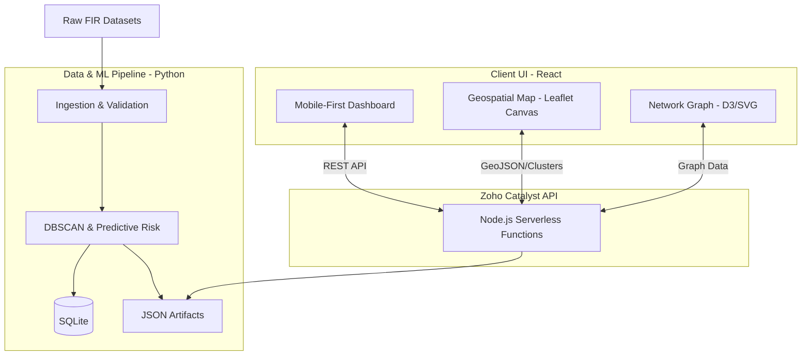
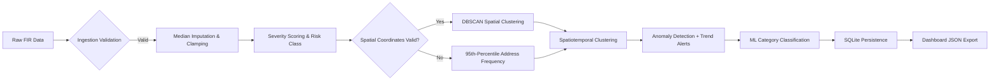
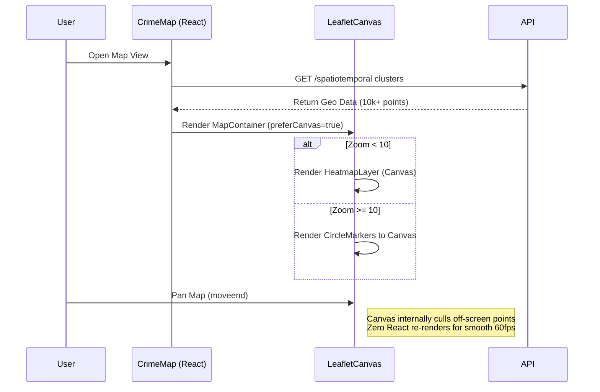
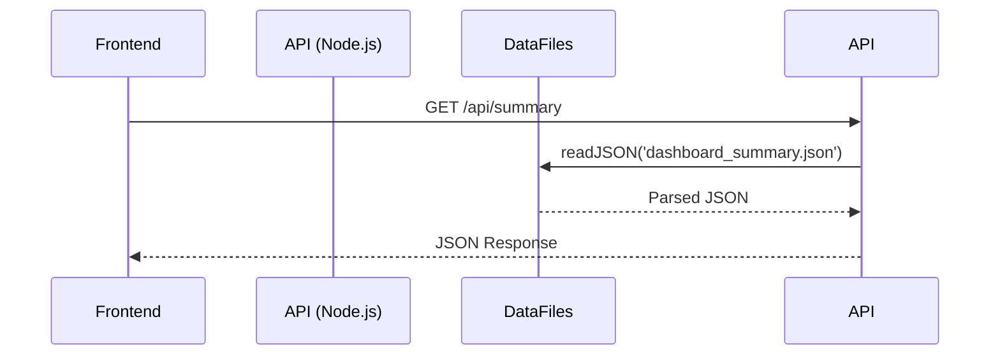

# Crime DNA 

<div align="center">
  
</div>

## Problem Statement

The **Karnataka State Police (KSP)** currently manages crime data through fragmented, manual, and Excel-based systems, resulting in isolated records and limited analytical capability. This siloed approach restricts the ability to perform integrated, state-wide analysis and prevents the discovery of deeper criminal patterns, networks, and trends.

As a result, policing remains largely **reactive** rather than proactive, with minimal use of advanced analytics or AI to support decision-making. The **State Crime Records Bureau (SCRB)** lacks tools for real-time visualization, predictive insights, and network-based crime intelligence, making it difficult to identify hotspots, track repeat offenders, or uncover hidden associations between cases.

There is a critical need for an intelligent, AI-driven platform that integrates crime data across jurisdictions and enables advanced analytics, geospatial visualization, network analysis, and predictive modeling to support proactive and evidence-based policing.

## Solution: CrimeDNA

<div align="center">
  
  <p><i>Fig 1: CrimeDNA Workflow Diagram</i>
</div>

CrimeDNA is an AI-powered Crime Intelligence Platform that unifies crime data from multiple police sources and transforms it into a living behavioral intelligence network. Instead of treating each FIR or case as an isolated record, the platform analyzes behavioral patterns, modus operandi, locations, timelines, and relationships to create a unique "Crime DNA" for every incident.

### Multi-Layer Filtering Engine & Intelligence

CrimeDNA features a dynamic, non-destructive **Filtering Engine** that powers our intelligence:

1. **Ingestion Validation**: Prevents data loss via median-imputation and mathematical clamping rather than destructive row-dropping.
2. **Predictive Risk Classification**: Computes a robust `Severity_Score` weighted heavily by IPC codes (e.g. Murder, NDPS, POCSO) and victim multipliers to generate a `Predicted_Risk_Class`.
3. **Hybrid Spatial Hotspot Detection**: Automatically executes **DBSCAN Spatial Clustering** on valid coordinate data. If coordinates are corrupted, it gracefully falls back to a strict 95th-percentile statistical frequency thresholding on localized address strings to flag true `Hotspot_Flag` instances.
4. **Graph Intelligence Mapping**: Pre-computes structural syndicate links (`Syndicate_Link_Flag`) to feed into the network graph visualization.

### Spatiotemporal & Anomaly Intelligence

- **Spatiotemporal Clustering**: Groups crimes by district, time-of-day bucket, and rounded coordinates to detect repeat crime patterns at specific locations and times.
- **Anomaly Detection**: Uses Isolation Forest (for datasets with 10+ crime categories) or Z-score thresholding to flag statistically anomalous crime spikes.
- **Trend Alerts**: Compares recent 3-month crime counts against historical averages to generate CRITICAL/ELEVATED alerts for emerging trends.
- **Forecasting**: Linear regression trend extrapolation for the top 5 crime categories, projecting 6-month forward predictions.
- **Socioeconomic Correlation**: Maps crime rates against socioeconomic indicators (population density, literacy, urbanization) for 32 Karnataka districts.

---

## Architecture

### High Level Design (HLD)



### Low Level Design (LLD)

#### 1. Data Pipeline Stages

The Python pipeline (`data_processing/`) executes 11 sequential stages:



#### 2. Map Rendering Optimization Logic



#### 3. Backend API Flow



---

## Dataset

The raw FIR data used in this project is sourced from Kaggle:
[FIR Details - Karnataka Police Dataset](https://www.kaggle.com/datasets/vanshangaria/fir-details-karnataka-police)

Download the dataset and place the CSV file at `data_processing/datasets/FIR_Details_Data.csv` before running with `--source real`.

---

## What Has Been Built

### 1. Data Processing & ML Pipeline (`data_processing/`)

A comprehensive Python pipeline with 11 stages:

| Stage | Component | Description |
|-------|-----------|-------------|
| 1 | `data_generation.py` | Generates mock FIR datasets for 3 police stations with 5 crime categories (Violent, Financial, Cyber, Property, Drug-related) |
| 2 | `data_processing.py` | Loads CSVs, aggregates datasets, trains TF-IDF + LogisticRegression classifier for crime categorization |
| 3 | `cleaner.py` | Non-destructive cleaning: deduplication, median imputation for missing coordinates (with district lookup table), string standardization, year/count clamping |
| 4 | `analytical_filters.py` | Time bucket generation, severity scoring (IPC-weighted + victim/accused multipliers), severity bucketing (LOW/HIGH/CRITICAL) |
| 5 | `graph_filters.py` | Syndicate link detection (3+ accused), location recurrence counting, modus operandi clustering |
| 6 | `ml_filters.py` | Historical archive flagging, noise flagging, DBSCAN hotspot labeling with statistical fallback, risk class mapping |
| 7 | `alert_generator.py` | Spatiotemporal clustering, Isolation Forest anomaly detection, trend-based alert generation, summary builders |
| 8 | `pipeline_orchestrator.py` | Orchestrates all stages, builds network/forecast/socioeconomic data, exports dashboard JSON artifacts |
| 9 | `main.py` | CLI entry point with argparse (`--run`, `--all`, `--generate-mock`, `--source`, `--limit`, `--no-analysis`, `--no-classification`) |
| 10 | `database_operations.py` | SQLAlchemy ORM models (Station, Fir, FilteredCrime) with SQLite persistence |
| 11 | `filter_engine.py` | Dynamic multi-layer filter engine composing pure `df → df` transforms |

**Key Features:**
- **Non-destructive filtering**: Never drops rows; uses imputation and flagging instead
- **District coordinate lookup**: 30+ Karnataka districts with lat/lng mappings for coordinate imputation
- **Hybrid hotspot detection**: DBSCAN clustering with 95th-percentile statistical fallback
- **Socioeconomic data**: Real district-level indicators for all 32 major Karnataka districts
- **Mock data generation**: 300 synthetic FIRs across 3 stations with realistic crime templates

### 2. Backend API (`functions/crime_dna/`)

A Node.js Express API deployed on Zoho Catalyst with 16 endpoints:

| Endpoint | Description |
|----------|-------------|
| `GET /` | Health check with version info |
| `GET /api/health` | System health with data availability status |
| `GET /api/summary` | Full dashboard summary (KPIs, distributions, alerts, clusters) |
| `GET /api/trends` | Monthly trends, crime type & district distributions |
| `GET /api/hotspots` | Hotspot count, spatiotemporal clusters, locations |
| `GET /api/severity` | Severity distribution, risk class distribution, critical count |
| `GET /api/offenders` | Syndicate link count, anomaly count, total FIRs |
| `GET /api/network` | Network graph nodes and edges |
| `GET /api/spatiotemporal` | Spatiotemporal cluster details |
| `GET /api/alerts` | Filterable alerts (by district, alert level) |
| `GET /api/anomalies` | Anomaly count, rate, total FIRs |
| `GET /api/forecast` | Crime category forecasts with historical data |
| `GET /api/associations` | Syndicate links, network nodes/edges |
| `GET /api/socioeconomic` | District-level socioeconomic indicators |
| `GET /api/firs` | Paginated, filterable FIR records |
| `GET /api/firs/:id` | Single FIR detail with linked entities |

### 3. Frontend Dashboard (`client/`)

A mobile-first React dashboard with TypeScript and Vite:

| Page | Features |
|------|----------|
| **Dashboard** | KPI cards (7 metrics), crime category bar chart, risk class pie chart, responsive layout with mobile fallback |
| **Crime Map** | Fullscreen Leaflet map with CartoDB Voyager tiles, heatmap layer (zoom < 10), native canvas markers (zoom >= 10), severity-colored popups |
| **Network Graph** | Interactive SVG physics-based force graph with drag-and-drop, hover highlighting, node grouping by crime type/district/syndicate |
| **Trends** | Monthly FIR trend line chart (24 months), crime type distribution bar chart, district comparison chart |
| **Alerts** | Filterable alert cards (CRITICAL/ELEVATED/NORMAL), district chips, trend indicators with percentage change |
| **Severity** | KPI cards, severity bar chart, severity pie chart, ML-based risk class distribution |
| **FIR Records** | Paginated table with search, crime type/severity filters, sortable columns |

---

## Quick Start

### Prerequisites

- Python 3.10+
- Node.js 18+

### One-command setup (Windows)

From the repo root, run:

```powershell
.\dev.ps1
```

This single script:
1. Installs Python dependencies
2. Generates mock FIR data and runs the full 11-stage pipeline
3. Installs Node dependencies (if not already present)
4. Opens `http://localhost:5173` in your browser
5. Starts the Vite dev server (port 5173) and Express API (port 3000) together

**Options:**

```powershell
# Skip pipeline if data already exists
.\dev.ps1 -SkipPipeline

# Use real Kaggle dataset, limit rows for speed
.\dev.ps1 -Real -Limit 5000
```

### Manual steps (if needed)

```powershell
# 1. Python pipeline only
cd data_processing/orchestration
python main.py --all --no-classification

# 2. UI only (after pipeline has run)
cd client
npm install
npm run dev
```

### Pipeline CLI reference

```
python orchestration/main.py --help

Options:
  --run                Run the full intelligence pipeline
  --all                Generate mock data and run the full pipeline
  --generate-mock      Generate mock FIR CSV datasets only
  --source [real|mock] Data source (default: real)
  --limit N            Number of rows to load from real dataset
  --no-analysis        Skip analytical, graph, ML, and alert layers
  --no-classification  Skip ML category classification (use if labeled_crimes.csv is absent)
```

---

## File Structure

```text
CrimeDNA/
├── dev.ps1                     # One-command dev launcher (pipeline + UI)
├── client/                     # React Frontend (Mobile-First, TypeScript)
│   ├── public/                 # Static assets (KSP Logo, icons, favicon)
│   ├── src/
│   │   ├── api.ts              # Backend API integration (16 endpoints)
│   │   ├── App.tsx             # React Router setup (7 routes)
│   │   ├── App.css             # Global styles, sidebar, responsive nav
│   │   ├── index.css           # CSS variables, typography, glassmorphism
│   │   ├── index.tsx           # React root entry
│   │   ├── types.ts            # TypeScript interfaces
│   │   ├── utils.ts            # Helpers: crime/district formatting, media query hook
│   │   ├── components/
│   │   │   ├── Preloader.tsx   # Cinematic intelligence preloader
│   │   │   ├── Navbar.tsx      # Desktop sidebar + mobile bottom nav
│   │   │   ├── MobileHeader.tsx
│   │   │   ├── KpiCard.tsx     # Animated KPI metric card
│   │   │   └── AlertCard.tsx   # Severity alert card with trend
│   │   └── pages/
│   │       ├── Dashboard.tsx
│   │       ├── MobileDashboard.tsx
│   │       ├── CrimeMap.tsx
│   │       ├── NetworkGraph.tsx
│   │       ├── Trends.tsx
│   │       ├── Alerts.tsx
│   │       ├── Severity.tsx
│   │       └── FIRList.tsx
│   ├── vite.config.ts
│   ├── tsconfig.json
│   └── package.json
├── functions/                  # Zoho Catalyst Node.js Backend API
│   └── crime_dna/
│       ├── index.js            # Express server (16 REST endpoints)
│       ├── package.json
│       ├── data/               # Pipeline output JSON (served by API)
│       │   ├── dashboard_summary.json
│       │   ├── network_data.json
│       │   ├── forecast_data.json
│       │   └── socioeconomic_data.json
│       └── services/
│           ├── chat.service.js
│           ├── stt.service.js
│           └── response.service.js
├── data_processing/            # Python ML Pipeline
│   ├── orchestration/
│   │   ├── main.py             # CLI entry point
│   │   ├── pipeline_orchestrator.py  # 11-stage pipeline
│   │   └── test_filters.py     # Filter test suite
│   ├── src/
│   │   ├── ingestion/
│   │   │   ├── cleaner.py
│   │   │   └── filtering/
│   │   │       ├── data_processing.py   # CSV loading, aggregation, ML classification
│   │   │       ├── data_generation.py   # Mock FIR generator
│   │   │       ├── database_operations.py  # SQLAlchemy ORM (Station, Fir, FilteredCrime)
│   │   │       └── config.py            # Paths, stations, categories
│   │   ├── features/
│   │   │   ├── analytical_filters.py   # Severity scoring, time buckets
│   │   │   ├── graph_filters.py        # Syndicate links, location recurrence
│   │   │   ├── ml_filters.py           # DBSCAN, hotspot/risk labeling
│   │   │   ├── alert_generator.py      # Spatiotemporal, anomaly, trend alerts
│   │   │   └── graph_builder.py        # Adjacency list builder utility
│   │   ├── loaders/
│   │   │   ├── sqlite_loader.py        # Bulk DataFrame → SQLite loader
│   │   │   └── neo4j_loader.py         # (Placeholder)
│   │   └── utils/
│   │       ├── filter_engine.py        # Composable df→df filter engine
│   │       └── dashboard_filters.py    # Operational dashboard query filters
│   ├── requirements.txt
│   └── data/                   # Pipeline output (gitignored)
│       ├── crime_pipeline.db
│       └── 03_processed/       # JSON artifacts consumed by API
├── docs/
│   ├── SCHEMA.md               # SQLite schema + JSON artifact reference
│   ├── API_REFERENCE.md        # Full API endpoint reference
│   ├── DATA_FLOW.md            # End-to-end data flow documentation
│   ├── HLD.md                  # High-level design document
│   ├── LLD.md                  # Low-level design document
│   ├── PIPELINE_COMMANDS.md    # Pipeline CLI command reference
│   ├── aryan_keshri_todo.md    # PDF dossier export feature spec
│   └── ruhi_sharma_todo.md     # Bilingual voice chatbot feature spec
├── images/
├── catalyst.json
├── .catalystrc
└── README.md
```

---

## Performance Optimizations

- **Map Canvas Rendering**: Leaflet uses `preferCanvas={true}` to render via HTML5 Canvas. Leaflet natively culls off-screen points for 60fps panning with tens of thousands of data points.
- **Network Graph**: Custom SVG physics simulation with `requestAnimationFrame`, avoiding heavy D3 library overhead while maintaining interactive drag-and-drop.
- **Pre-computation Architecture**: The API is a thin JSON file-server — all analysis is done at pipeline time, so every endpoint responds in under 10ms regardless of dataset size.

---

## Future Work

### 1. Standardized Dossier Export (PDF Generation)
**Assigned to: Aryan Keshri**
- One-click PDF export from map popups and data tables
- Map snapshotting via html2canvas
- Standardized intelligence report layout
- Client-side generation using jspdf + html2canvas
- See `docs/aryan_keshri_todo.md` for full specification

### 2. Bilingual Voice-Based Data Analytics Chatbot
**Assigned to: Ruhi Sharma**
- Speech-to-Text (Whisper/Google STT) for Kannada & English
- Text-to-Speech (Google/Azure TTS) with Kannada support
- LangChain SQL agent for natural language database querying
- Bilingual response generation (Kannada/English)
- See `docs/ruhi_sharma_todo.md` for full specification

---

## Contributors

1. **Arnav Eluri** - Reva University, Bengaluru, KA
   - Python data pipeline architecture, ML feature engineering, orchestration
2. **Aryan Keshri** - Acharya Institute of Technology, Bengaluru, KA
   - Frontend React dashboard, network graph visualization, PDF export planning
3. **Ruhi Sharma** - Reva University, Bengaluru, KA
   - Backend API design, voice chatbot architecture planning
4. **Spandana S R** - Reva University, Bengaluru, KA
   - Data ingestion, cleaning, and validation logic
